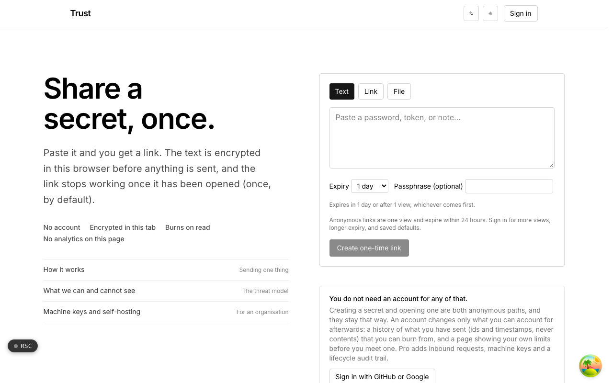
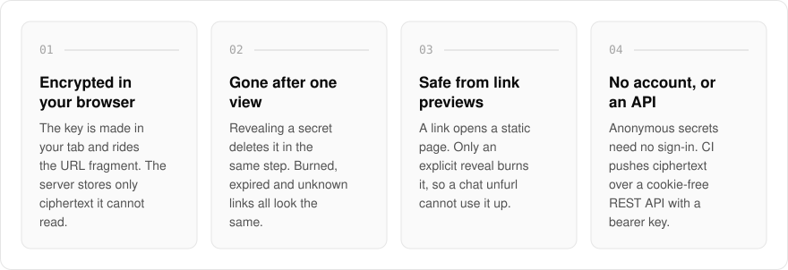
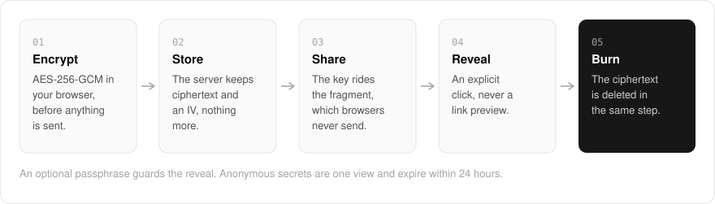
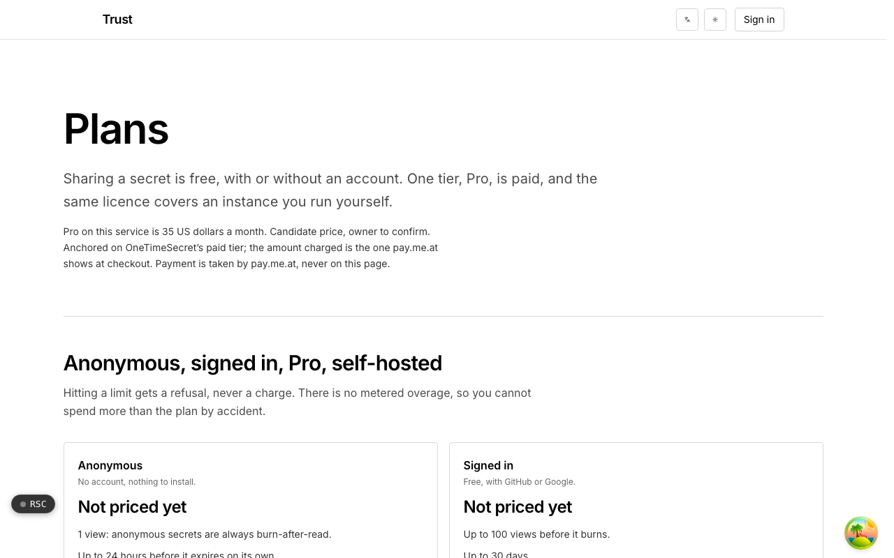

  <picture>
    <source media="(prefers-color-scheme: dark)" srcset=".github/assets/hero-dark.png">
    
  </picture>

<h1 align="center">trust.me.at</h1>

<strong>Keep your secrets. Share them safely.</strong>

  
  
  
  

  <a href="https://trust.me.at">Website</a> ·
  <a href="#features">Features</a> ·
  <a href="#how-it-works">How it works</a> ·
  <a href="#screenshots">Screenshots</a> ·
  <a href="#built-with">Built with</a>

API keys live in a `.env` on one laptop, recovery codes in a notes app, shared passwords in a pinned chat message, and every so often one of them gets pasted into a ticket that keeps it readable for years. I built trust.me.at as a zero-knowledge secrets manager: a vault for passwords, API keys and env vars, encrypted with AES-256-GCM in your browser under a key only your passphrase or recovery key opens, plus a way to hand any of them to someone as a link that stops working once it has been read. My server holds ciphertext and never receives a key. It also gets credentials out of CI, and in from customers, without anyone making an account.

  <picture>
    <source media="(prefers-color-scheme: dark)" srcset=".github/assets/overview-dark.svg">
    
  </picture>

## Why trust.me.at

| The usual way to keep or share a credential | trust.me.at |
| --- | --- |
| A `.env` on one laptop, a notes app, a pinned message | An encrypted vault with search, tags, environments and version history |
| Pasted into a chat, an inbox or a ticket, where it stays | A link that stops working once it has been opened |
| The service can read what it stores | Encrypted in your browser; the server holds only ciphertext |
| A chat app unfurling the link can use it up | Opening shows a static page, and only an explicit reveal burns it |
| Getting one back from a customer means an account or an email thread | An ask link lets them encrypt it for you, no account needed |

## Features

- **An encrypted vault**: passwords, API keys, env vars and notes, sealed in your browser under a vault key wrapped by your passphrase (PBKDF2-SHA-256, 600,000 iterations) and by a recovery key shown once. Names, tags and notes are encrypted too; the server stores ids, revision numbers, timestamps and ciphertext. Free accounts hold 50 items.
- **Version history**: the last 10 versions of every item are kept, on every plan, and any of them can be restored.
- **`.env` in and out**: paste a `.env` file to import it, and export any filtered set as `.env` or JSON. Both happen in the browser, alongside a generator for new random secrets.
- **Share from the vault**: any item becomes a one-time link encrypted under its own fresh key. The vault locks itself after 15 idle minutes.
- **No recovery without you**: lose both your passphrase and your recovery key and nobody, including me, can open the vault. That is the price of a server that never holds a key.
- **Encrypted in the browser**: the key is generated in your tab and never reaches the server. The server stores a format version, the ciphertext and an IV, and nothing beside it names a recipient, a title or an IP address.
- **Burn on read**: revealing a secret deletes the stored ciphertext in the same step, and a burned, expired or never-existing link all give the same response.
- **Safe from link previews**: opening a link shows a static page and only an explicit reveal burns the secret, so a chat app unfurling it cannot use it up.
- **No account needed**: anonymous secrets are one view and expire within 24 hours. Signing in with GitHub or Google raises the view count and expiry and adds a history of ids and timestamps, never contents.
- **Passphrases and burn tokens**: an optional passphrase guards the reveal (repeated guessing destroys the secret), and a one-shot burn token destroys a secret without the link or an account.
- **Ask links**: someone outside your organisation can send you a secret without an account. They encrypt it in their browser and only you can open it.
- **Cookie-free REST API**: push ciphertext from CI and scheduled jobs with a bearer key that is shown once and stored only as a hash.
- **Self-hostable**: storage is your own Redis or Upstash, deployment files ship with the app, and the licence is verified offline with no call home.

## How it works

  <picture>
    <source media="(prefers-color-scheme: dark)" srcset=".github/assets/flow-dark.svg">
    
  </picture>

Your browser encrypts everything with AES-256-GCM before anything is sent. Vault items are sealed under a vault key that only your passphrase or recovery key unwraps, and the server stores the two wrapped copies of that key beside each item's ciphertext. To share an item, it is encrypted again under a fresh key that travels in the URL fragment, the part of a link browsers never transmit, so whoever holds the link holds the key and nobody else does. A reveal is an explicit click, and the stored ciphertext is deleted in the same atomic step, so a race between two readers has exactly one winner.

## Screenshots

<table>
  <tr>
    <td width="50%"><picture><source media="(prefers-color-scheme: dark)" srcset=".github/assets/hero-dark.png"></picture> The landing page: the vault, and a no-account form that turns a secret into a one-time link.</td>
    <td width="50%"><picture><source media="(prefers-color-scheme: dark)" srcset=".github/assets/pricing-dark.png"></picture> Plans: the anonymous, signed-in, Pro and self-hosted limits.</td>
  </tr>
</table>

## Built with

  
  
  
  
  
  

- Next.js 16 (App Router), React 19, TypeScript
- Tailwind CSS 4
- Web Crypto (AES-256-GCM, PBKDF2) for client-side encryption, Argon2id for share-link passphrases
- Redis or Upstash for vault and secret storage, with compare-and-set edits and an atomic consume for one-winner reveals
- Better Auth (GitHub, Google, and OpenID Connect sign-in)
- oRPC + TanStack Query
- Self-hostable with Docker

## Part of the me.at family

trust.me.at is one of my [`*.me.at`](https://me.at) apps. They share one design system, account, and app shell. Development happens in a private monorepo; this repository is the project's public-facing home.

## License

Source-available. See [LICENSE](LICENSE).
